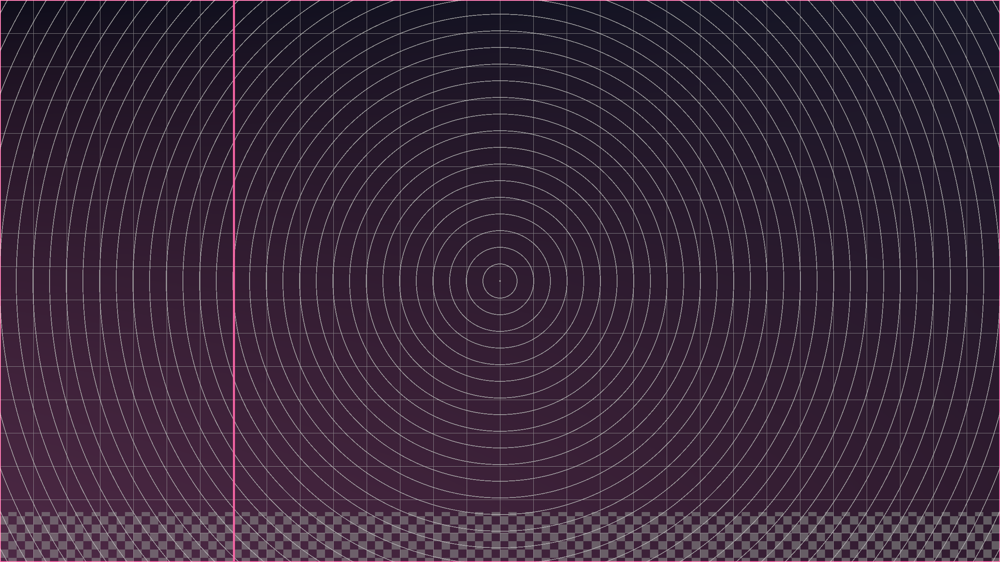

# hyprbeat

**An open-source rhythm game that lives on your desktop background, compatible
with the osu! beatmap format. Built for Hyprland/Wayland.**

hyprbeat renders on your compositor's background layer via the wlr layer
shell. Click the exposed desktop and the wallpaper becomes a playable rhythm
game; focus another window and it pauses; leave it idle and an autoplay demo
bot keeps your desktop alive. No servers, no accounts, no hosted content.

> **Status — phase 2 of 8** (see [`CONTEXT.md`](CONTEXT.md) §10): the audio
> engine is in place — a cpal output callback doubles as the game clock
> (game time derives exclusively from the audio sample counter, never the
> wall clock), symphonia decodes mp3/ogg/flac/wav behind a SHA-256 cache, an
> RT-safe mixer drives a music-synced gradient pulse, and a degraded
> wall-clock fallback keeps the wallpaper alive when the audio device is
> gone (visible as a pulsing amber band). **Beatmaps, gameplay and the config
> file arrive in phases 3–8.** What you get today: an animated, optionally
> music-synced gradient wallpaper with a scale test card, pause/resume via
> `SIGUSR1`/`SIGUSR2`, and a tap-to-sound latency instrument
> (`--latency-test`).



*A headless `--testcard` render: logical 1920×1080 at 1.25× scale becomes a
2400×1350 buffer; the 2 px border, 1 px grid, rings and checker strip stay
locked to logical pixels.*

## Requirements

- Linux + a [wlr-layer-shell](https://gitlab.freedesktop.org/wlroots/wlr-protocols/-/blob/master/unstable/wlr-layer-shell-unstable-v1.xml)
  compositor: **Hyprland**, sway or niri
- A Vulkan or GLES driver (any Mesa stack; software lavapipe works too)
- Rust ≥ 1.85 (edition 2024)

## Build & run

### NixOS (primary target)

```sh
nix develop          # devshell: toolchain + wayland/libxkbcommon/vulkan-loader/alsa-lib
cargo run --release -- --audio assets/test-tone.wav --timeout 12
```

### Other distros

System deps: `wayland`, `libxkbcommon`, `vulkan-loader`, `alsa-lib`
(+ `pkg-config` at build time), then:

```sh
cargo build --release
./target/release/hyprbeat --testcard --timeout 10
```

Every live run carries a **safety timeout** (default 120 s, `--timeout 0`
disables) so a broken build can never strand your desktop. This default is
a phase-1 development guard and will retire when real mode switching lands
(phase 7).

## CLI (phase-2 dev/diagnostic set)

```
--headless          render one frame offscreen to a PNG and exit (no compositor)
--size WxH          headless logical size [default: 1920x1080]
--scale SCALE       headless simulated output scale [default: 1.0]
--out PATH          headless PNG output path
--testcard          draw the scale test pattern over the gradient
--audio PATH        load an audio file (mp3/ogg/flac/wav) and sync the wallpaper
                    to it — the clock, the animation and pause all hang off the
                    audio stream; decodes cache in ~/.cache/hyprbeat/decoded/
--volume V          master volume 0.0–1.0 [default: 0.7]
--offset-ms N       universal audio offset in ms [default: 0]
--buffer N          output buffer in frames — the latency floor of the
                    input→sound budget; 0 = device default (measured 32 ms
                    on PipeWire); falls back to device default when refused
                    [default: 256 ≈ 5.3 ms at 48 kHz]
--no-audio          force the degraded wall-clock path (amber band appears)
--latency-test      input → sound → photon tap report (empty workspace; click
                    the desktop once for keyboard focus, then tap keys)
--probe             CONTEXT.md §14 Q-1/Q-2: check on_demand keyboard focus and
                    relative-pointer deltas on a background-layer surface
--fps FPS           idle frame-rate cap [default: 30]
--timeout SECS      quit after SECS seconds; 0 disables [default: 120]
--version / --help
```

Examples:

```sh
hyprbeat --audio assets/test-tone.wav --timeout 20   # music-synced animation
kill -USR1 $(pgrep hyprbeat)                          # pause (audio clock freeze)
kill -USR2 $(pgrep hyprbeat)                          # resume (rebase, seamless)
hyprbeat --latency-test --timeout 30                 # tap-to-sound report
hyprbeat --testcard --timeout 10                     # watch the background
hyprbeat --headless --scale 1.25 --out /tmp/card.png
hyprbeat --probe --timeout 8                          # input diagnostics
RUST_LOG=hyprbeat=debug hyprbeat --timeout 0          # verbose run
```

## Phase validation (dev machine)

Run [`dev/validate-phase1.sh`](dev/validate-phase1.sh) /
[`dev/validate-phase2.sh`](dev/validate-phase2.sh) on the Hyprland machine —
they walk the exit criteria: devshell build, offline gates, headless PNG,
live gradient + test card at 100 %/125 %, music-synced animation with the
committed test tone, decode-cache miss→hit, scripted SIGUSR1/2 pause +
rebase, the degraded wall-clock path, and the `--latency-test` budget.

Quality gates that run anywhere: `cargo fmt --check`,
`cargo clippy -- -D warnings`, `cargo test` (82 unit tests; parser/rules
slider tests grow per phase — all pure modules are I/O-free by design) and
`cargo bench --bench audio` (clock math, RT mixer, resampler).

## Architecture

The single source of truth is [`CONTEXT.md`](CONTEXT.md) — threading model,
the audio-clock invariant, the two-mode state machine, decision log and
build phases. Quick sketch:

- **smithay-client-toolkit** + **calloop** on the main thread (no winit —
  its layer-shell support is still unmerged)
- one **wgpu** surface per output on the background layer; instanced-quad
  rendering arrives with gameplay sprites (phase 4+)
- frame-callback driven rendering with an idle fps cap; occlusion pause is
  compositor-dependent — Hyprland keeps sending callbacks under fullscreen
  (measured ~1 % of one core; a real pause arrives with phase-7 mode
  switching)
- **cpal** raw output callback is the one true clock (D-03/D-04): the RT
  mixer counts samples, mixes music + hitsounds, publishes the loudness
  envelope the gradient pulses to; a wall-clock fallback (visible amber band)
  covers missing/lost audio devices — never a crash
- fractional scaling via `wp_fractional_scale_v1` + `wp_viewporter`:
  buffer = `round(logical × scale)`, mapped 1:1 back onto logical pixels
- empty input region by default (desktop keeps every click); input handling
  is phase 4, mode switching phase 7

## Legal

This is a standalone tool. We do not host or distribute copyrighted
beatmaps; what users do with their own files is their responsibility.
hyprbeat is an independent reimplementation of publicly documented mechanics
and file formats — it is **not** affiliated with osu! or ppy, contains zero
code from osu!lazer, and the product name deliberately never contains
"osu".

Bundled assets are CC-licensed or original only: the hitsounds and test tone
(`assets/`) are original synthesis by the committed `dev/gen_assets.py`
(CC0, see `assets/hitsounds/NOTICE.md`).

## License

MIT — see [LICENSE](LICENSE).
